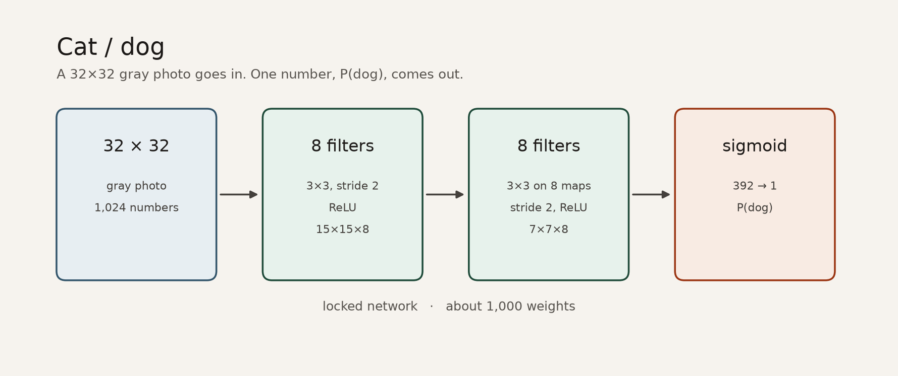

# numpy-neural-net-play

Building a neural network from scratch with NumPy !!
No frameworks: every forward pass, gradient, and update is written by hand.

The same track will later be redone in PyTorch (`torch-neural-net-play`)
(will do later)

## Structure

- `notebooks/` — one notebook per step, for exploring and understanding
- `nn/` — engine: clean, reusable code 
- `tests/` — gradient checks, run with `python -m tests.test_gradients`

## Check-lists:

- [x] 01 — Matrix multiplication (NumPy)
- [x] 02 — Single neuron (weights, bias, activation)
- [x] 03 — Layer of neurons
- [x] 04 — Stacking layers
- [x] 05 — Forward pass
- [x] 06 — Loss functions
- [x] 07 — Backpropagation
- [x] 08 — Gradient checking
- [x] 09 — Training on a data

## Cat / dog



Eight filters read the 32×32 gray photo. Eight more read a neighborhood of those maps. The 392 numbers go straight into a sigmoid. This is the locked network, saved at epoch 6: training loss 0.689, test loss 0.694, test accuracy 0.54 on 140 photos.

```python
from nn.checkpoint import load_checkpoint

net, meta = load_checkpoint("models/cat_dog.npz")
```

The run is in `notebooks/train_cat_dog.ipynb`. The photos in `data/cat_dog` stay on your machine.
